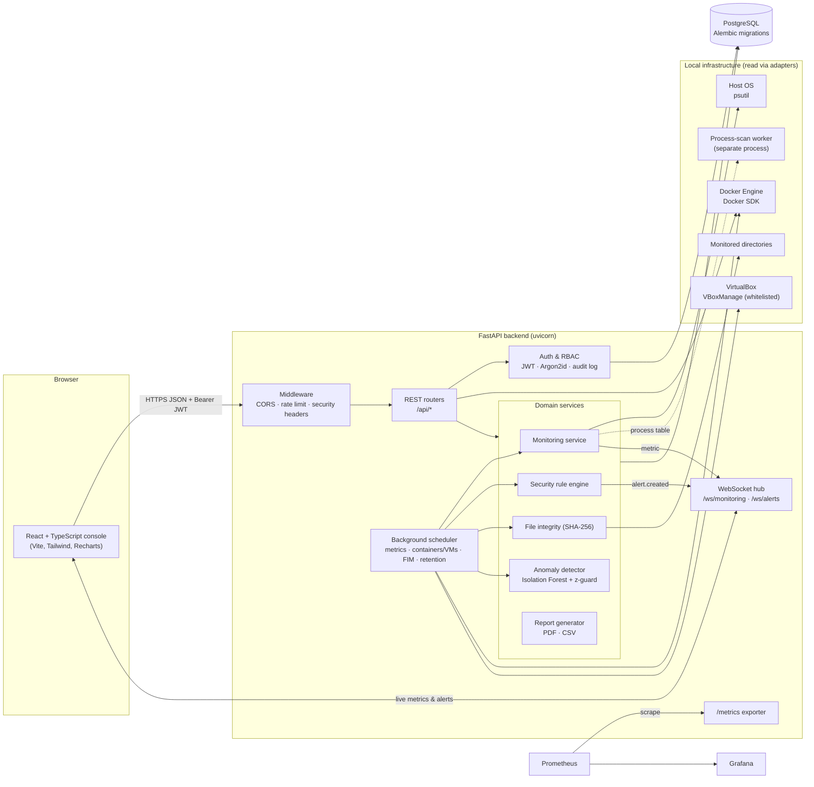
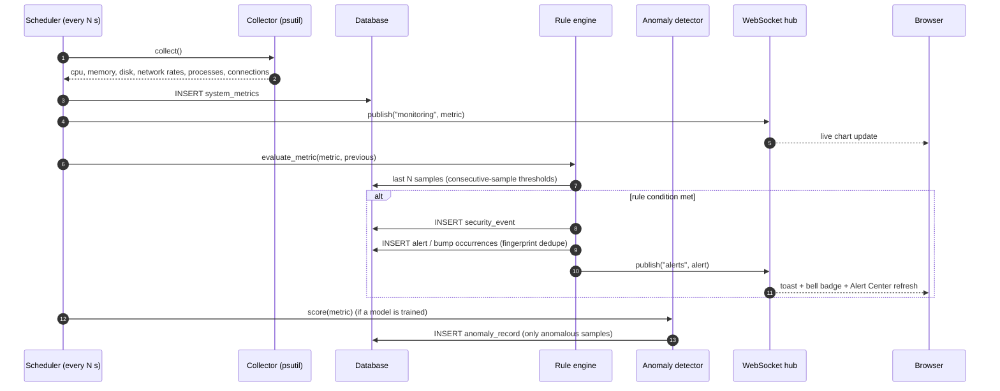

# CloudGuard — System Architecture

## 1. Overview

CloudGuard is a three-tier application: a React single-page console, a FastAPI service that
contains all monitoring, detection and analysis logic, and a relational database (PostgreSQL;
SQLite is supported for quick local runs and tests). The backend talks to the real local
infrastructure through narrow adapters: **psutil** for the host, the **Docker Engine API** for
containers and a validated **VBoxManage** wrapper for VirtualBox VMs.

## 2. Backend modules

| Folder (`backend/app/…`) | Responsibility |
|---|---|
| `core/` | Settings from env (`config.py`), DB engine/session (`database.py`), JWT + Argon2 (`security.py`), auth dependencies & RBAC (`deps.py`), rate limiter, audit helper |
| `models/` | SQLAlchemy 2.0 ORM models (see [DATABASE.md](DATABASE.md)) |
| `schemas/` | Pydantic request/response models and validation rules |
| `api/routes/` | REST and WebSocket endpoints, one router per domain |
| `monitoring/` | `collector.py` (psutil metrics, OS info, network), `procscan.py` (process table in a worker process), `service.py` (persist, evaluate, broadcast, Prometheus gauges) |
| `docker_integration/` | `adapter.py` real Docker SDK adapter + labelled mock; `service.py` sync & container detections |
| `virtualization/` | `vbox.py` safe VBoxManage wrapper + labelled mock; `service.py` sync & VM detections |
| `security_engine/` | `rules.py` default transparent rules; `engine.py` evaluation of metrics, logins, failures |
| `integrity/` | `fim.py` path safety checks, SHA-256 baselines, change detection |
| `ml_engine/` | `detector.py` Isolation Forest training, evaluation, scoring, explanations |
| `reports/` | `generator.py` data aggregation and PDF/CSV rendering |
| `services/` | alerts (dedupe + push), runtime settings, seeding, background scheduler |
| `realtime/` | thread-safe WebSocket broadcast hub |

## 3. Key flows

### 3.1 Metric collection → detection → live alert

### 3.2 Authentication

1. `POST /api/auth/login` → user looked up by username or email (constant-time dummy verify for unknown users).
2. Lock check (`locked_until`), Argon2id verification, every attempt stored in `login_attempts`.
3. Rule engine evaluates the attempt: brute force (→ temporary lockout), password spraying, new source IP, repeated logins.
4. On success: short-lived access JWT + refresh JWT whose `jti` is stored in `refresh_tokens`.
5. `POST /api/auth/refresh` rotates the refresh token; **re-use of a rotated token revokes every session of that user** and records a high-severity event.

### 3.3 Container action (authorisation path)

`POST /api/containers/{id}/stop` → identifier validated against `^[a-zA-Z0-9][a-zA-Z0-9_.-]{0,127}$` →
row resolved in the DB → `can_manage(user, owner_id)` (admin or assigned owner, otherwise **404** so
existence is not leaked) → `expected_stop_at` recorded so the stop is not flagged as a crash →
whitelisted adapter call → audit log entry → resync.

## 4. Integration modes

| Mode | Host metrics | Docker | VirtualBox | Purpose |
|---|---|---|---|---|
| `real` (default) | psutil | Docker SDK against the local Engine | `VBoxManage` | Production / demonstration on real infrastructure |
| `mock` | psutil (always real) | in-memory demo containers | in-memory demo VMs | Automated tests and offline demos; the UI shows a **“Demo mode”** banner |

When Docker or VirtualBox is not installed, `real` mode reports `available: false` with setup
instructions; no containers/VMs are shown as monitored and the rest of CloudGuard keeps working.

## 5. Design decisions

* **Synchronous SQLAlchemy in a threadpool, async only at the edges.** Endpoints are plain `def`
  functions (run in FastAPI's threadpool); the scheduler runs blocking collection with
  `asyncio.to_thread`. A thread-safe bridge (`realtime/bus.py`) lets sync code publish to async
  WebSocket clients.
* **Process scanning in a separate process.** Enumerating ~350 processes on Windows takes 1–2 s of
  Python work; in a thread it starved concurrent requests through GIL convoying (measured: an
  unrelated 6 ms request took ~800 ms). The scan now runs in a persistent worker process and is
  cached for 5 s; concurrent requests stay at ~6 ms.
* **Transparent detection first, ML second.** Every rule has an explicit condition string, tunable
  parameters and a recommended response. ML is optional, refuses to predict without enough data,
  and every anomaly carries a per-feature explanation.
* **Alert de-duplication.** Alerts carry a fingerprint (`rule:resource_type:resource`); repeated
  detections bump `occurrences`, `last_seen_at`, title and (only upwards) severity instead of
  flooding the Alert Center. Resolved alerts are never reused.
* **Schema portability.** One Alembic migration runs on PostgreSQL and SQLite; the suite passes on
  both (`TEST_DATABASE_URL`). All timestamps are stored and returned as UTC.

## 6. Frontend structure (`frontend/src`)

| Path | Contents |
|---|---|
| `lib/api.ts` | fetch wrapper: bearer token, transparent refresh-token rotation, typed `ApiError` |
| `lib/auth.tsx`, `lib/theme.tsx` | auth and theme contexts |
| `lib/hooks.ts` | `useApi` (loading/error/polling) and `useLiveChannel` (WebSocket with reconnect) |
| `components/ui` | design-system primitives (cards, badges, tables, modal, toasts, stat tiles, meters) |
| `components/charts` | Recharts wrappers with validated palette, legends and tooltips |
| `components/layout` | sidebar, top bar with live notification bell, protected/admin routes |
| `pages/` | one page per module (lazy-loaded) |
