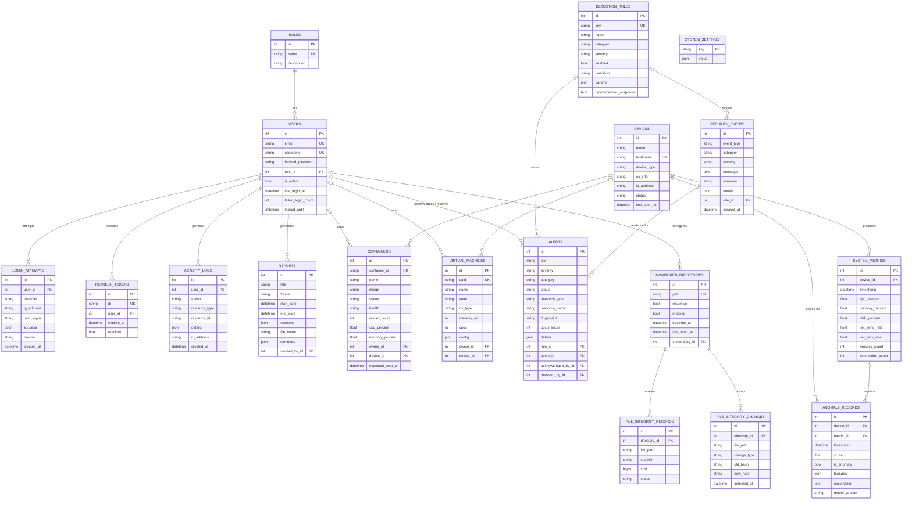

# CloudGuard — Database Design

PostgreSQL is the primary database (SQLite is supported for local runs/tests). The schema is created
and versioned with **Alembic** (`backend/alembic/versions/0001_initial_schema.py`). All tables with
mutable rows have `created_at` / `updated_at` timestamps (UTC). Integrity is enforced with primary
keys, foreign keys (with explicit `ON DELETE` behaviour), unique constraints, `CHECK` constraints on
enumerations and indexes on every column used for filtering or time-range queries.

## Entity–relationship diagram



## Tables

| Table | Purpose | Notable constraints / indexes |
|---|---|---|
| `roles` | `admin`, `user` | `name` unique |
| `users` | accounts, Argon2id hashes, lockout state | `email`, `username` unique; FK `role_id` `ON DELETE RESTRICT` |
| `login_attempts` | login history & failed-login tracking | indexes on `identifier`, `success`, `created_at`, `(ip_address, created_at)` |
| `refresh_tokens` | refresh-token rotation and revocation | `jti` unique; cascade on user delete |
| `devices` | monitored hosts (local host registered automatically) | `hostname` unique |
| `system_metrics` | time series of host telemetry | index `(device_id, timestamp)`; cascade on device delete; pruned after `retention_days` |
| `containers`, `virtual_machines` | discovered workloads, ownership for RBAC | `container_id` / `uuid` unique; owner FK `SET NULL` |
| `detection_rules` | transparent, tunable rules | `key` unique; `CHECK severity IN (…)` |
| `security_events` | every detection & auth failure (immutable log) | index `(category, created_at)` |
| `alerts` | actionable, de-duplicated alerts with workflow | `CHECK status`, `CHECK severity`; index `(status, severity)`, `fingerprint` |
| `monitored_directories` | FIM configuration | `path` unique |
| `file_integrity_records` | current SHA-256 baseline per file | unique `(directory_id, file_path)` |
| `file_integrity_changes` | modified / new / deleted history | indexes on `change_type`, `detected_at` |
| `anomaly_records` | ML anomalies with explanations | index on `timestamp`, `is_anomaly` |
| `activity_logs` | audit trail | index `(user_id, created_at)`, `action` |
| `reports` | generated report metadata (files stored in `data/reports`) | FK `created_by_id` |
| `system_settings` | runtime-tunable settings (intervals, ML) | key/value JSON |

## Normalisation notes

* Reference data (roles, rules) is stored once and referenced by foreign key.
* Alerts reference their rule and originating event instead of copying rule metadata (the
  recommended action is copied deliberately so the alert keeps the guidance that applied at
  detection time even if the rule is later edited).
* FIM separates current state (`file_integrity_records`) from history (`file_integrity_changes`).
* Report files live on disk; the table stores metadata and a small summary for listing.

## Migrations

```bash
cd backend
alembic upgrade head          # create / update schema
alembic downgrade base        # drop everything
alembic revision --autogenerate -m "describe change"   # after editing models
alembic check                 # verify models and migrations agree
```
